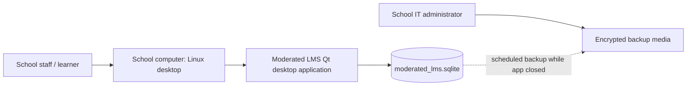

# Deployment and Role User Manual

## Deployment diagram

## Installation guide (Ubuntu/Kali Linux)
1. Install C++ compiler, CMake, Qt 6 Widgets/SQL development packages and OpenSSL development headers:
   `sudo apt update`
   `sudo apt install build-essential cmake qt6-base-dev libssl-dev`
2. Extract the release archive into a directory writable by the intended operator.
3. Open a terminal in the project directory.
4. Configure: `cmake -S . -B build`
5. Build: `cmake --build build -j2`
6. Run: `./build/moderated_lms`
7. Confirm the SQLite database file is created in the working directory.
8. Sign in with the seeded demo account only for demonstration. Create real accounts and change all temporary credentials before any pilot.
9. Back up the database while the application is closed. Test restoration to a separate directory before relying on the backup.

## Administrator quick guide
- Sign in as Administrator.
- Use Create user to add accounts; assign the correct role and department. Use the View filter to display all users or only students, lecturers, HoDs, administrators, departments, courses, enrolments or assignments. Search narrows the visible table. Select a row and choose Edit selected to edit supported records.
- Add departments and courses, assign a lecturer to each course, and enrol students.
- Use unique usernames and course codes. Give temporary passwords through an approved secure channel.
- Use Edit selected to change account name, username, role, department, active status or reset the password. Export table to CSV saves the current filtered table for LibreOffice Calc or Excel. Remove selected enrolment deletes only the student-course relationship; existing submissions remain.

## Lecturer quick guide
- Sign in as Lecturer.
- Create an assignment for a course assigned to you; enter a title, description, deadline and maximum mark.
- Use Individual extension or Extend whole class and record a reason where applicable.
- Select a submission and choose Mark selected submission. Enter raw mark, written feedback and a reason for the audit trail.
- Marks remain hidden from students until HoD release.
- Check the effective deadline and penalty rule agreed with the school.

## Head of Department quick guide
- Sign in as HoD.
- Review submissions in the department moderation queue.
- Select a marked submission and choose Moderate selected mark. Add a meaningful moderation note.
- After moderation, select Release selected mark to publish the mark and feedback.
- Use View mark audit to inspect recorded mark changes. A production release must restrict audit visibility by department.

## Student quick guide
- Sign in as Student.
- Open My learning and select the assignment.
- Check the displayed effective deadline; it may include a class-wide or individual extension.
- Select Submit/resubmit work and enter the work text or a description of work stored elsewhere. This prototype does not upload arbitrary files.
- Confirm the displayed submission status. Late work is accepted but a penalty may apply.
- Marks and feedback appear only after HoD release.

## Backup and recovery
- Close the application before copying the SQLite database file.
- Store backups in an access-controlled location, preferably encrypted.
- Periodically restore a copy into a test folder and verify accounts, courses, assignments and audit rows.
- Establish a retention period and secure disposal process with the school.

## Release notes
### v1.0 prototype
- Role-specific desktop workflows, SQLite persistence, password hash/salt, assignments, extensions, submission/mark/moderation/release lifecycle, mark audit.
- Limitations: current submission text only; no upload interface; prototype-level architecture; automated coverage and security review incomplete.
### v1.1 maintenance target (CR1)
- Class-wide extensions stored on assignments and shown as the effective deadline in the student list.
- Regression-test the extension precedence: individual extension > class extension > original deadline.

## Source code map
The application is split by responsibility. Startup is in `src/main.cpp`; SQLite setup and password utilities are in `src/database.cpp`; login is in `src/login_dialog.cpp`; shared main-window helpers are in `src/main_window.cpp`; and each role has a separate file under `src/ui/`. Public declarations live in `include/lms/`. This keeps the administrator dashboard isolated from lecturer, HoD and student workflows.
