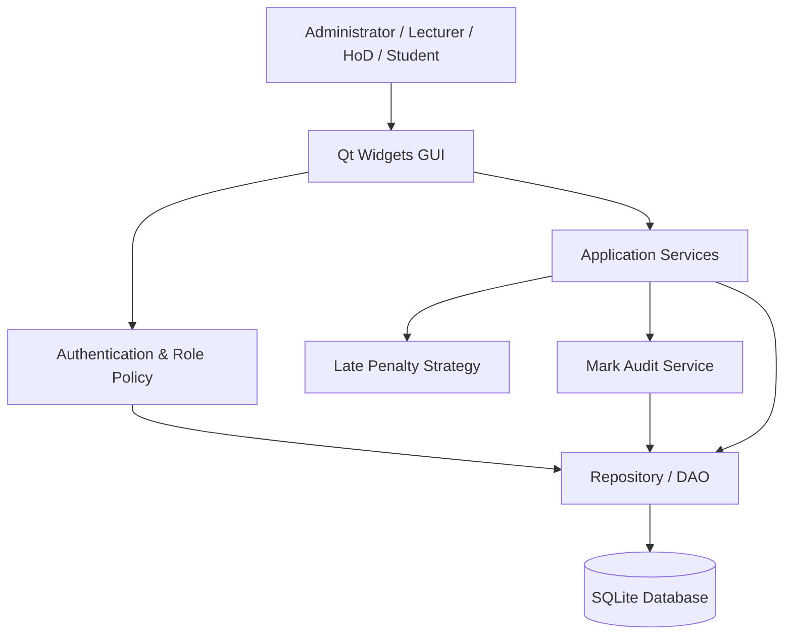
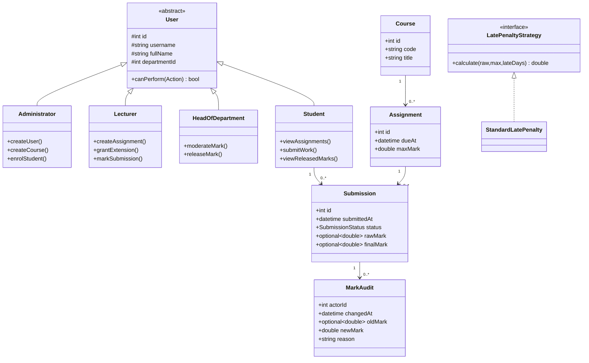
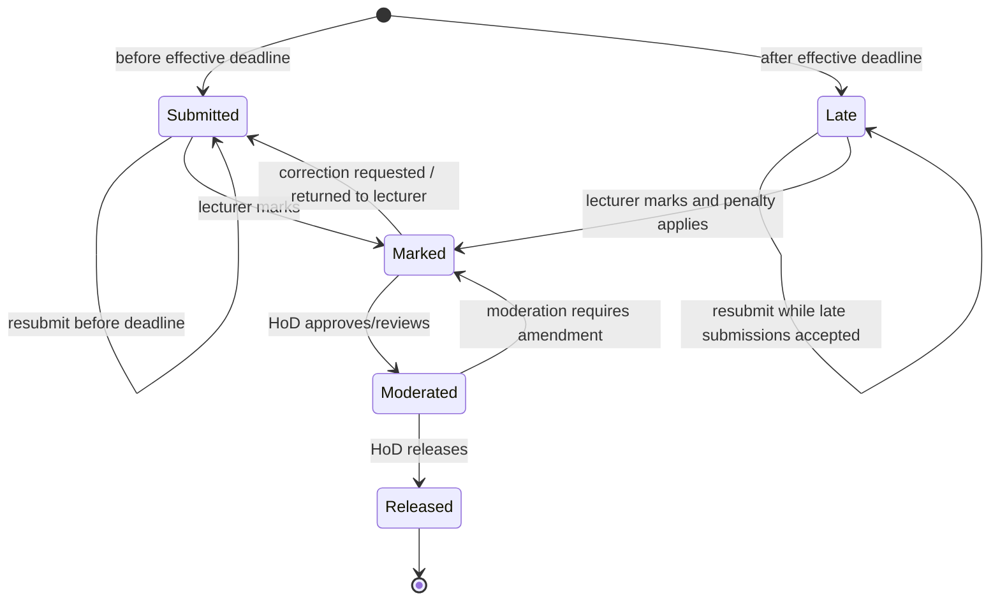
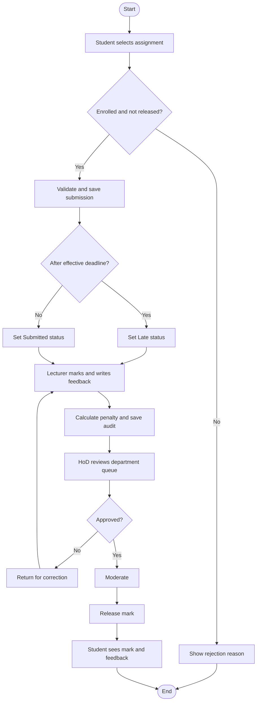
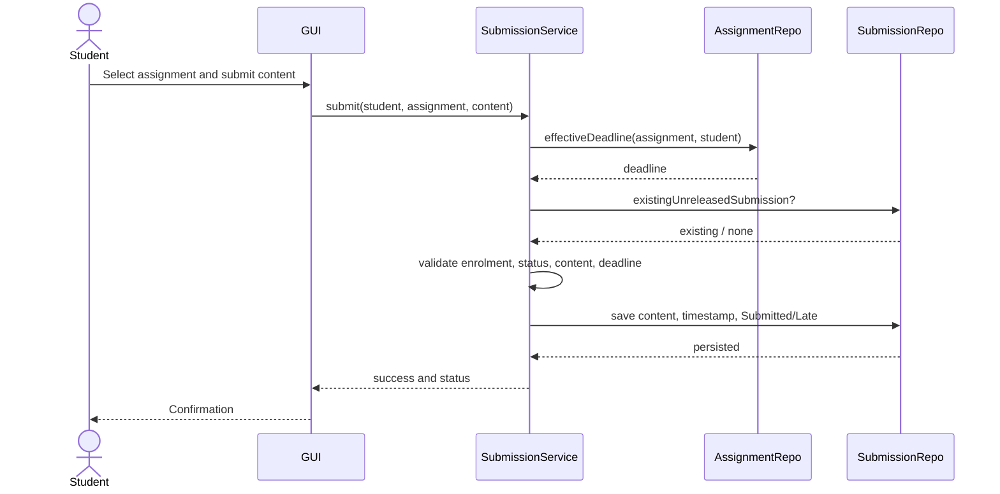
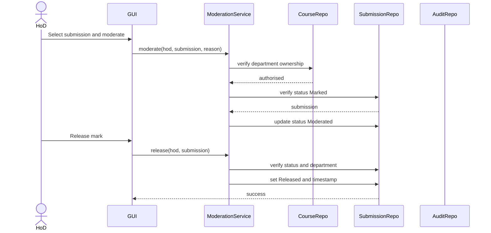
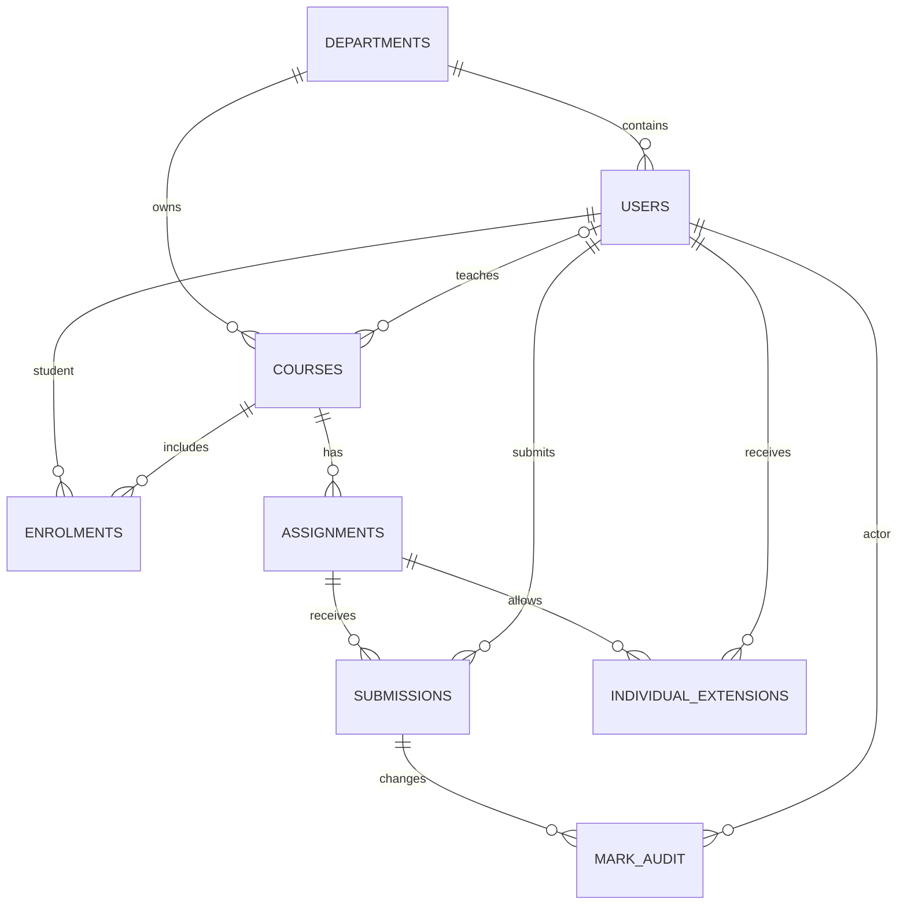

# Software Design Document

## 1. Architecture
Use a layered desktop architecture:
- **Presentation layer:** Qt Widgets login dialog, role-specific tabs, forms, tables and validation messages.
- **Application/workflow layer:** authentication, role checks, submission lifecycle, late-penalty calculation, extension rules, moderation and release.
- **Data-access layer:** repositories/DAO methods using Qt SQL prepared statements.
- **Persistence layer:** SQLite database with foreign keys, uniqueness constraints and indexes.
- **Security utility:** OpenSSL scrypt password derivation, random per-user salt and audit-event handling.

The current prototype source is concentrated in `src/main.cpp` for convenient packaging. For a maintainable final release, split it into `ui/`, `services/`, `repositories/`, `domain/` and `security/` translation units. The assignment specifically assesses fidelity to the design, so the final code should be refactored to match these boundaries before claiming full marks.

### Alternative considered
A web client/server architecture was rejected because the brief explicitly excludes web/mobile interfaces and requires offline operation on a school computer or local network. A Qt desktop application with SQLite is more aligned with the case study and has fewer runtime dependencies. If several concurrent school computers must write to one shared database, SQLite file sharing is not a substitute for a proper server database; deployment assumptions must be clarified.

## 2. Component diagram

## 3. Class diagram (design target)

**Important consistency note:** the diagram is a design target. The current prototype uses a role string in the database and role-conditional GUI construction; it does not yet implement the abstract `User` inheritance hierarchy shown above. To meet the explicit assignment requirement, implement the domain classes and polymorphic role policy in source code before claiming full compliance.

## 4. Design patterns and SOLID
1. **Repository/DAO:** centralises database access, makes SQL persistence replaceable and improves integration testing. In the current prototype, prepared SQL is issued directly from GUI handlers; this should be refactored into repositories.
2. **Strategy:** late-penalty policy should be represented by an interface such as `LatePenaltyStrategy` and a concrete `StandardLatePenalty`, making the policy independently testable and replaceable.
3. **Factory (recommended):** `UserFactory` can create role-specific domain objects from persisted role values.
4. **Observer (optional):** status-change notifications can update UI elements without coupling submission logic to views.

SOLID application: Single Responsibility separates UI, policy and persistence; Open/Closed allows new penalty strategies; Liskov Substitution ensures role subclasses satisfy the User contract; Interface Segregation keeps role capabilities small; Dependency Inversion makes workflow services depend on repository/policy interfaces rather than SQL implementation details.

## 5. Submission state machine

The application should enforce transitions in a workflow service, not rely only on which buttons are visible.

## 6. End-to-end activity diagram

## 7. Sequence diagrams
### Submit assignment (including late/resubmission)

### Moderate and release marks

## 8. ERD and data dictionary

| Table | Purpose | Key columns / constraints |
|---|---|---|
| departments | Department directory | `id` PK; `name` unique |
| users | Accounts and role | `id` PK; `username` unique; role check; department FK; salt/hash |
| courses | Course catalogue | `id` PK; `code` unique; department FK; optional lecturer FK |
| enrolments | Student-course relationship | Composite PK `(student_id, course_id)`; both FKs |
| assignments | Assessment definitions | `id` PK; course FK; `max_mark > 0`; original deadline; class extension |
| individual_extensions | Per-student deadline | Composite PK `(assignment_id, student_id)`; due date and reason |
| submissions | Current submission and mark | Unique `(assignment_id, student_id)`; status; marks; feedback; timestamps |
| mark_audit | Immutable mark-change history | `id` PK; submission/actor FKs; old/new marks; timestamp; reason |

The schema is broadly normalised: department data is stored once; courses reference departments; enrolment is a junction table; assignment data is separated from submissions; audit events are separate rows. The current design stores the current submission only, so it does not preserve every resubmission version. That is a known limitation and a possible enhancement.

## 9. Traceability matrix
| Requirement | Use case | Design element | Source area | Test |
|---|---|---|---|---|
| FR-01 authentication | Login | Authentication service, users | `LoginDialog`, password helpers | AT-01/02 |
| FR-02 role access | All | User/role policy | `MainWindow` role branches | AT-01, negative role tests |
| FR-03 accounts | Administer users | User/Department | `buildAdmin` | AT-03/04 |
| FR-04 departments/courses | Administer catalogue | Department/Course | `buildAdmin` | AT-05 |
| FR-05 lecturer assignment | Assign lecturer | Course–User relation | `buildAdmin` | AT-05 |
| FR-06 enrolments | Enrol student | Enrolment | `buildAdmin` | AT-06 |
| FR-07 assignment creation | Create assignment | Assignment | `buildLecturer` | AT-07 |
| FR-08 individual extension | Extend deadline | IndividualExtension | `buildLecturer` | Extension test |
| FR-09 class extension | Extend whole class | Assignment.class_extension | `buildLecturer`, student query | AT-16 |
| FR-10 assignment list | View assignments | Course/Assignment | `buildStudent` | AT-06/16 |
| FR-11 submit/resubmit | UC-01 | Submission | `buildStudent` | AT-08/10 |
| FR-12 late penalty | UC-02 | LatePenaltyStrategy (target) | marking handler | AT-09/12 + boundary tests |
| FR-13 mark/feedback | UC-02 | Submission | marking handler | AT-11 |
| FR-14 hide unreleased marks | UC-03 | Release policy | student query | AT-15 |
| FR-15 moderation | UC-03 | HoD workflow | `buildHod` | AT-13 |
| FR-16 release | UC-03 | Submission status | `buildHod` | AT-14 |
| FR-17 audit | UC-02 | MarkAudit | `mark_audit` insert | AT-17 |
| FR-18 persistence | All | SQLite | `initDatabase` | AT-18 |
| FR-19 validation/errors | All | GUI and DB constraints | input handlers | negative tests |
